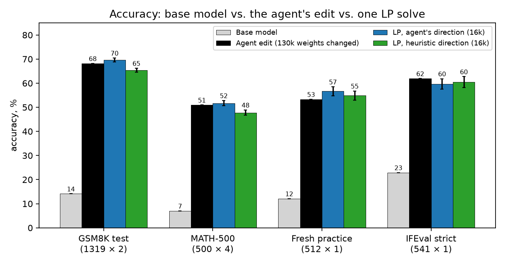

# weight-space-lp

Qwen3.5-0.8B often gets stuck repeating itself while it thinks. In
[*Sparks of Weight-Space Programming*](https://rikiyat.github.io/blog/weight-space-programming/) (Takehi et al., MIT CSAIL), an LLM agent fixed
this by hand-editing the model's weights, testing its ideas with a budget of 50 batched runs of the model
([logs](https://github.com/RikiyaT/lm_understand-logs/tree/main/exp8_math)). Its fix turned out to be simple: in layers 15 and 19,
push the hidden state away from one "loop direction".

Given that direction, this repo picks which neurons to change and by how much with a single linear-program solve
(about a minute on a laptop). The result matches the agent's edit while changing 8× fewer weights. A second version
takes the direction from automatically detected loops in the model's own traces, with no LLM, and gets about 93% of the way.

The full write-up (method, findings, steering baseline, caveats) is in [docs/WRITEUP.md](docs/WRITEUP.md).

## Results



Accuracy on held-out benchmarks (problems × samples each; the base model got 1 sample on MATH-500). Error bars are the
paired SE of each edit's difference from the agent edit. The two LP edits differ only in where the loop direction
comes from: the agent's, or a heuristic one taken from the model's own looping traces with no LLM involved (layers 15 and 19 are
still taken from the agent). Exact numbers and the eval protocol are in
[results/benchmarks](results/benchmarks/README.md).

A constant steering vector of the same size along the same direction works about as well (50.8 on MATH-500). So the
fix is "push away from one direction by the right amount", and the LP's contribution is finding that amount in one
solve and baking it into ordinary weights.

## How it works

**The matrix being edited.** Each layer's MLP ends with `down_proj`, a `[1024, 3584]` matrix. At every token it takes
the 3,584 neuron activations `h` and writes `W·h = Σ_j h_j·w_j` into the 1,024-d residual stream: each neuron `j` adds
its own column `w_j`, scaled by how strongly it fires.

**The agent's edit.** The agent wrote 4 pairs of short texts, each a piece of productive reasoning and a looping
version of it, and took the difference between the model's average hidden state on the two. That difference is the
loop direction `u` (`[1024]`). It then took the 64 columns per layer that add the most `u` on looping text compared with
productive text, and subtracted 6× each column's component along `u`. Every column changes by a multiple of the same `u`, so the change is rank-1:
`ΔW = u vᵀ`, with one number `v_j` per neuron.

**The LP.** At token `t` the edit adds `(v · h_t) · u` to the residual stream: a push along `u` whose size is linear
in `v`. So given `u`, and activations recorded from the model's own traces split into looping tokens `R` and productive
tokens `P`, choosing `v` is a linear program:

```
min_v  Σ_j |v_j|  +  C · Σ slack
s.t.   v · h_t ≤ −δ     t ∈ R    (push looping tokens away from u)
       |v · h_t| ≤ ε    t ∈ P    (barely move productive tokens)
```

The L1 objective keeps `v` sparse, so the LP also picks the neurons: 8 per layer for the edit above. This replaces
the agent's choice of columns and amounts, and its search. The heuristic version also replaces the text pairs: its `u`
is the difference between the average hidden state on looping and productive tokens in real traces. The LP is solved
with PDHG on MPS/CUDA ([`src/wslp/lp.py`](src/wslp/lp.py)).

## Reproduce

```bash
uv sync                                  # Python 3.12; MPS or CUDA for activation caching and PDHG
bash scripts/fetch_exp8.sh               # the paper's released logs -> third_party/ (CC BY 4.0)
python scripts/e0_astra_structure.py     # rebuild the agent's edit, extract (u, S, v)  -> cache/astra_L{15,19}.npz
python scripts/export_astra_edit.py      # edits/astra_p50c.safetensors

# activations: released traces, plus our base generations on fit_gen (GPU job scripts/gpu/e0_job.sh)
python scripts/e1_collect_released.py
python scripts/e1_collect_fitgen.py

# LP sweep: eps (1.0 broad, 0.25 selective), neurons per layer, activations, direction (astra = agent's, real = heuristic), [push multiplier]
python scripts/e2_sparsity_sweep.py 1.0 8,32,128 acts_fitgen astra
python scripts/e2_make_edits_sweep.py acts_fitgen_astra_eps1.0 8,32,128 shift    # -> edits/shift_k{8,32,128}

# generation evals on a cloud GPU (SkyPilot; any >= 24 GB CUDA GPU)
sky launch -c wslp sky/eval.yaml --env JOB=scripts/gpu/e3_finalists.sh -i 20 --down -y
python scripts/benchmark_tables.py && python scripts/make_figures.py
```

`python -m wslp.eval.run_vllm <ckpt> <out> --sets math500 --n 4` runs one eval;
`python -m wslp.eval.ckpt <out> <edit.safetensors>` builds an edited checkpoint.

## Layout

```
src/wslp/      lp.py (LP, PDHG) · astra.py · collect.py · loops.py · edits.py · eval/ (vLLM, grading, IFEval, steering plugin)
scripts/       e0_* reproduce · e1_* activations · e2_* LP sweep · e3_overlap · benchmark_tables · make_figures · gpu/ cloud jobs
edits/         every evaluated edit (.json metadata; .safetensors are gitignored, rebuilt by the scripts)
steer/         steering vectors
results/       reproduction/ · dev_sweep/ · benchmarks/ · analysis/ · figures/ · gpu/ (per-run scores) · spend.md
docs/          WRITEUP.md · PLAN.md (the original plan, with a status box)
```

Compute: about 18 H100-hours and 1.5 A100-hours on Lambda, about $63 ([ledger](results/spend.md)).

## Credit

The problem, the agent's edit, the base traces and the eval protocol come from [*Sparks of Weight-Space Programming*](https://rikiyat.github.io/blog/weight-space-programming/)
by Rikiya Takehi, Jayden Teoh, Alex Zhang and Omar Khattab (MIT CSAIL), via their released logs
([RikiyaT/lm_understand-logs](https://github.com/RikiyaT/lm_understand-logs), CC BY 4.0). Their logs are
fetched into `third_party/`, not redistributed here.
