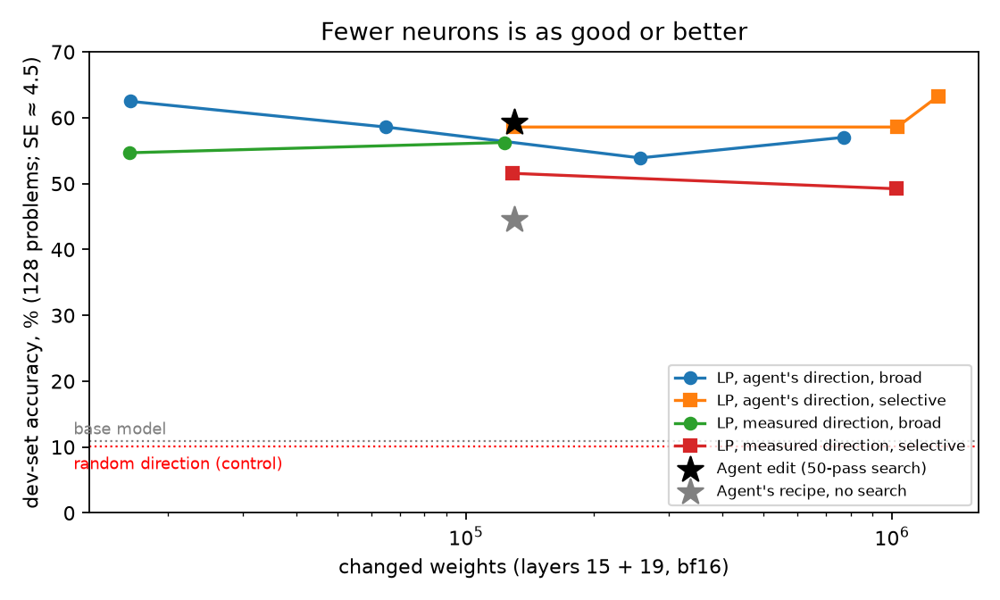
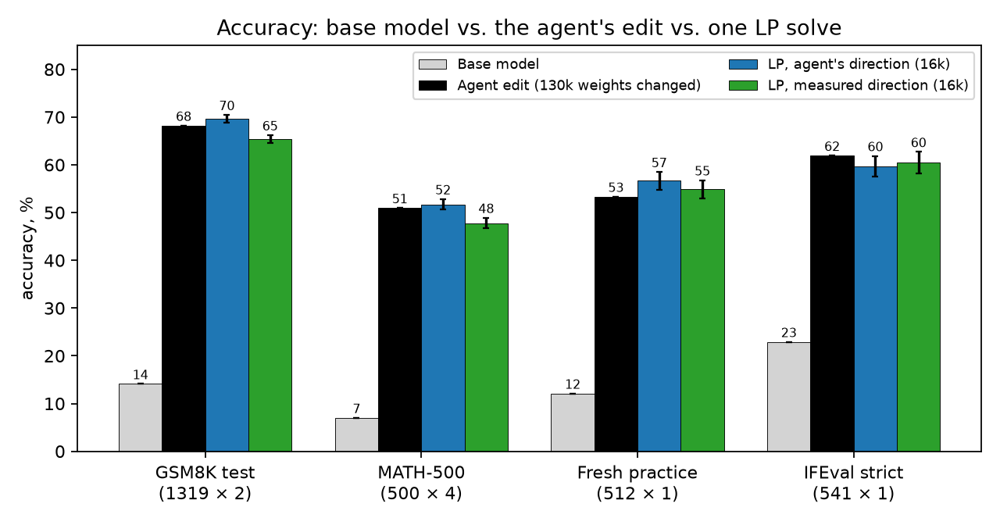

# Write-up

## Background

In [*Sparks of Weight-Space Programming*](https://rikiyat.github.io/blog/weight-space-programming/) (Takehi et al., MIT CSAIL;
[logs](https://github.com/RikiyaT/lm_understand-logs/tree/main/exp8_math)), an LLM agent (OpenAI's "Astra") hand-edited
Qwen3.5-0.8B's weights to stop it from looping while it thinks. It could inspect the weights freely but had a budget
of 50 forward passes, each a batched run of the model (about 64 sequences on average) on practice problems or texts of
its choosing, with no gradients. The run took 158 turns and about 16 hours of wall-clock time (20.3 hours in the
logs, including a 4.7-hour outage). Its final edit took MATH-500 from 7.9% to 48.1% in the authors' logs. That edit turns out to be **rank-1**: it pushes the hidden
state along a single direction. Once you know that direction, choosing *which neurons and how much* is a linear
program. This project tests whether one LP solve can stand in for the agent's search.

## Why it is a linear program

The agent's edit to `mlp.down_proj` in layers 15 and 19 is

```
W = W0 − 6 · u (mask64 ⊙ uᵀW0)      i.e.  ΔW = u vᵀ,  v_j = −6·uᵀw_j on 64 chosen neurons, 0 elsewhere
```

`u` is a unit vector in the 1024-d hidden state. At token `t` the edit adds `(v · h_t) · u` to the residual stream,
where `h_t` is the 3,584-d `down_proj` input, and nothing else changes. That is **linear in `v`**. With activations
recorded from the model's own traces, split into looping tokens `R` and productive tokens `P`:

```
min_v  Σ_j |v_j|  +  C · Σ slack
s.t.   v · h_t ≤ −δ        t ∈ R    (push looping tokens away from u by at least δ)
       |v · h_t| ≤ ε       t ∈ P    (move productive tokens by at most ε)
```

The L1 objective makes `v` sparse, so the LP chooses the neurons. For exactly `k` neurons, solve once, keep the top
`k` by `|v_j|·std(h_j)`, then re-solve on that support. HiGHS took over 20 minutes per solve on these dense rows, so
[`src/wslp/lp.py`](../src/wslp/lp.py) uses **PDHG** (Chambolle–Pock, the algorithm under PDLP) on MPS/CUDA. It reaches
HiGHS's optimum to within 0.2% in about a minute.

## What we did

1. **Reproduced the agent edit** ([results/reproduction](../results/reproduction/README.md)). Rebuilt it from the
   released diff (sha256 match) and confirmed it is rank-1. Re-derived `u` from the agent's 4 text pairs (cosine
   1.0000) and matched the agent's own teacher-forced metric (−0.1032 vs. −0.1031). Built a vLLM eval harness that
   reproduces the logged MATH-500 numbers within noise (agent edit 50.0 vs. 48.1, base 7.0 vs. 7.9).
2. **Collected loop data.** A detector that flags repeated 16-token windows finds where loops start (median about 680
   tokens into the reasoning). We cached layer 15/19 activations for productive tokens, loop starts and tokens inside
   loops, from the paper's released base-model traces and from 512 of our own.
3. **Swept 14 edits on a dev set** of 128 held-out practice problems
   ([results/dev_sweep](../results/dev_sweep/README.md)), varying three things:
   - the direction: the **agent's**, or one **measured** from the model's own traces (mean activation on looping
     tokens minus productive tokens), with no LLM involved;
   - the number of neurons per layer, from 8 to all 3,584;
   - **broad** (ε = 1.0: productive tokens may move, so the edit becomes a near-constant push) vs. **selective**
     (ε = 0.25: the edit tries to act only on loops).

   Controls: a random direction, and the agent's recipe applied once without its search. The pick was **broad, 8
   neurons per layer**. "LP, agent's direction" and "LP, measured direction" below both mean that setting.
4. **Confirmed on untouched data** ([results/benchmarks](../results/benchmarks/README.md)): 512 fresh practice
   problems never used to fit or pick anything, GSM8K test, MATH-500 (4 samples per problem) and IFEval.
5. **Analysis and baselines**: neuron overlap, push strength of the measured direction, and a steering-vector
   baseline.





## Findings

- **Given the agent's direction, the LP matches the agent edit with 8× fewer weights.** It is within about a point of
  the agent edit on every benchmark, all within noise.
- **The search was worth something, and the LP replaces it.** The agent's recipe applied once without its search
  scores 44.5 on the dev set vs. 59.4 for the agent edit. One LP solve on the same direction scores 62.5.
- **With the measured direction (no LLM at all), the LP gets about 93% of the way.** It is about 3 points behind the
  agent edit on GSM8K test and MATH-500 and ties it on IFEval. The gap comes from the direction, not the push
  strength: pushing looping tokens 2×, 4× or 8× their measured excess along `u` scores 54.7, 54.7 and 55.5 on the dev set. The measured direction has cosine ≈ 0.6
  with the agent's.
- **The fix acts like a constant offset.** Fewer neurons did better (8 > 32 > 128), and selective edits did no better
  than broad ones. At layer 15 the LP's 8 neurons are active on 89% of tokens (a typical neuron: 16%), and their push
  barely varies from token to token (coefficient of variation 0.17; the agent edit's: 1.1). A linear probe can spot a
  loop once it is under way (AUC 0.93) but not at its start (0.73), so an edit that waits for a loop acts too late.
- **Different neurons, same fix.** The LP edit shares only 3 of 8 (layer 15) and 1 of 8 (layer 19) neurons with the
  agent's 64. Many sparse solutions exist; what matters is the push along `u`.
- **No collateral damage on IFEval.** The base model fails IFEval mainly by looping inside its thinking (73%
  truncated). Every edit fixes that, and they land within about 1 SE of each other.
- **Teacher-forced metrics mislead.** The agent's own log-probability metric ranked several edits wrongly, so every
  choice here was made by generating and grading answers.

## A steering vector does the same job

Since the best LP edit acts almost like a constant, we took its **average** push (`mean_t(v·h_t) · u`, norm 0.89 at
layer 15 and 0.67 at layer 19) and added it as a fixed vector to the *unedited* model at layers 15 and 19, through a
small vLLM plugin ([`src/wslp/eval/steer.py`](../src/wslp/eval/steer.py)):

| Steering vector added to the unedited model | Dev set (128) | MATH-500, 1 sample |
|---|---|---|
| 0.5 × LP edit's average push | 51.6 | |
| **1 × LP edit's average push** | **57.8** | **50.8** (agent edit 50.0, LP edit 53.2, same seed) |
| 2 × LP edit's average push | 31.2 (loops stop, reasoning breaks) | |
| 1 × agent edit's average push | 57.0 | |
| *for reference: LP edit / agent edit / base model* | *62.5 / 59.4 / 10.9* | |

A constant push along `u` recovers essentially the whole fix: within noise of both the agent edit and the LP edit
(−2.4 ± 1.9 vs. the LP edit on MATH-500). The strength matters and the window is narrow: half is too weak, double
breaks reasoning. So the diagnosis is **a direction and a dose**, and the token-by-token variation of the edit adds
little. What the LP contributes is (a) choosing the dose from data in one solve, with no search, and (b) building that
push into 8 neurons per layer of ordinary weights, so the fix ships inside a standard checkpoint with no
inference-time hooks. The agent's search found the same dose by trial and error.

## Evaluation protocol

All runs use the authors' sampling settings (`think35`): vLLM, thinking on, temperature 0.6, top-p 0.95, top-k 20,
presence penalty 1.5, up to 32,768 new tokens (a generation that hits the limit is *truncated*, almost always
because it is stuck in a loop); the last `\boxed{}` answer is graded with math-verify. IFEval uses
lm-eval's port of the official checkers, scored on the text after the last `</think>` (empty if the generation was
truncated while thinking). Differences are paired per problem against the agent edit.

Weight counts are weights whose stored bf16 value actually changed. The post's 131,072 for the agent edit counts every
weight in its 128 edited columns; 884 of them round back to their original value, so we count 130,188.

## Caveats

- One model (Qwen3.5-0.8B) and one behavior (loops in math reasoning). Generality is untested.
- The LP edit was picked from 14 candidates on the 128-problem dev set, then confirmed on data never used for picking.
  The headline numbers come from the confirmation sets only.
- The eval harness is a reimplementation (the authors' `weightenv` package is unreleased); it matches the logged
  numbers within sampling noise.
- Not done: the fixed compute-budget pipeline, choosing layers without the agent's help, and sampling-penalty and L2
  baselines. See the status box in [PLAN.md](PLAN.md).
